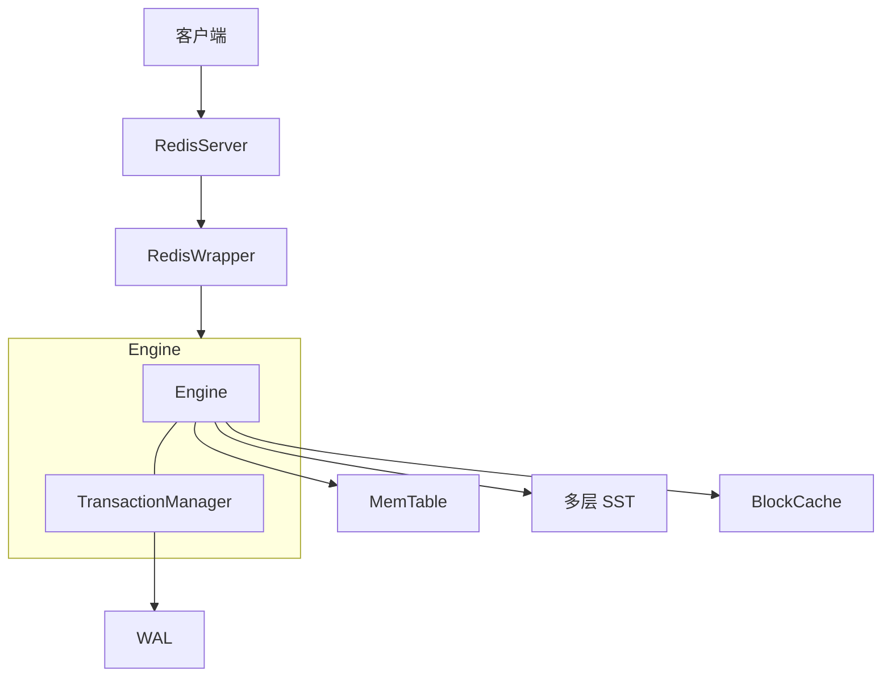

# Nailong-LSM-Go

Nailong-LSM-Go 是一个 **单机键值** 存储引擎，存储结构是 LSM Tree  
它是 [Nailong-LSM](https://github.com/MilLoong/Nailong-LSM) 的 Go 实现，包路径是 `nailong-lsm-go/pkg`

构建工具是 Go modules，在仓库根目录执行 `go build ./...` 编译，`go test ./...` 跑测试，`go run ./server` 启动 Redis 兼容服务，默认端口 `6379`。

测试规模、读路径对照和复跑命令见 [测试与性能记录](doc/test-results.md)。

## 概述 📒

- 🌐 **引擎：** 写入先进内存表，刷盘后成为不可变的 SST，再按层归并
- 🔐 **事务：** 用事务号做多版本并发控制，默认隔离级别是读已提交
- 🧾 **恢复：** 提交前先写预写日志，进程崩溃后重放已提交事务
- 🧱 **缓存：** 以访问次数优先、最近访问时间为次序淘汰 SST 数据块
- 🔌 **接口：** Go 的 `Engine`，以及一组常用 Redis 命令

## 技术栈 🧰

- **语言与工具：** Go（`go.mod` 声明 1.21）、Go Modules、`testing`、Testify
- **存储引擎：** LSM Tree、跳表 MemTable、分块 SST、分层 Compaction、Bloom Filter、堆式块缓存（`container/heap`）
- **事务与后台任务：** MVCC、WAL、goroutine、`context`、`sync`
- **服务与配置：** 标准库 `net` 提供 TCP 服务，使用 RESP 兼容部分 Redis 命令；BurntSushi/toml 解析配置，Logrus 记录日志

## 致谢 🙏

本仓库是 [Nailong-LSM](https://github.com/MilLoong/Nailong-LSM) 的 Go 版本。Nailong-LSM 从 Vanilla-Beauty 的 [Tiny-LSM](https://github.com/Vanilla-Beauty/tiny-lsm) 演进而来，原项目的实验划分、组件边界和 LSM 主体实现是这里的基础。

原项目参考了：

- [mini-lsm](https://github.com/skyzh/mini-lsm)
- [tinykv](https://github.com/talent-plan/tinykv)
- [leveldb](https://github.com/google/leveldb)

实验文档见 [Tiny-LSM Lab](https://vanilla-beauty.github.io/tiny-lsm/book/)。

## 未完成部分 🚧

- **组提交：** `WAL.Log` 在调用线程里写出并 `os.File.Sync`，没有后台批量刷盘
- **提交后不落盘：** `Commit` 末尾的 `Flush` 只往 `checkCh` 塞一个通知，真正写 SST 的是 200ms 轮询的 `flushWorker`
- **可串行化：** `detectConflicts` 只比较全局读事务号 `GlobalReadTxnID`，没有范围扫描和幻读判断
- **合并去重：** 合并按全部版本读入，同一个 key 的历史版本和删除标记一起写进新 SST
- **扫描：** 合并迭代器不跳过删除标记，调用方要自己用 `IsDeleted` 过滤
- **事务结束标记：** 提交时往内存表写一条 key 和 value 都为空的记录占位，刷盘时跳过
- **空值：** `Delete` 用空 value 当墓碑，`Get` 也把空 value 当成删除，空字符串无法作为 value 存下
- **事务状态文件：** `syncTxnStatus` 把活跃事务表写进 `committed_txns.json`，重启时却按已提交表读回来，判断哪些事务要重放时会落到错的一边
- **恢复检查点：** `wal.Recover` 的检查点固定传 0，每次都从第一个 WAL 文件开始重放，重放出来的记录只进内存表
- **WAL 清理：** `cleanWalWorker` 只看文件里的事务是否还在活跃表，不看这些记录是否已经写进 SST
- **大 value：** 没有 VLog 分离存储，value 全部留在 SST
- **Redis：** 只覆盖常用命令。字段名、链表元素和集合成员都在一个字符串里用 `|` 拼接，元素里再出现 `|` 时无法拆开

## 项目结构 📁

```text
pkg/
  skiplist/        跳表
  memtable/        内存表与刷盘
  block/           数据块
  cache/           块缓存
  sst/             SST 与块索引、布隆过滤器
  iterator/        合并、串接、选择迭代器
  lsm/             引擎、合并、事务
  wal/             预写日志与记录格式
  redis/           Redis 命令到键值的编码
  config/          配置
  common/          公共类型
  utils/           文件、布隆过滤器、游标
  logger/          日志
server/            基于 net 的 RESP 服务
example/           引擎、Redis、WAL 示例
tool/              SST 与 WAL 解析工具
config.toml        容量、块大小、布隆过滤器、WAL、Redis 前缀
```

## 主要功能 ✨

写入、读取、合并、事务、恢复、块缓存和 Redis 编码的做法和 Nailong-LSM 一样，Go 版只在这些地方不同：

- **事务：** 默认隔离级别是读已提交，`BeginWithIsolation` 可以指定其余三级。事务上的读写都走 `Engine`，用 `PutWithTxn` 和 `GetWithTxn` 带事务参数
- **后台协程：** 刷盘、合并、WAL 清理、事务状态回写各起一个 `goroutine`，退出时用 `context` 收尾
- **块缓存：** 用 `container/heap` 维护最近 K 次访问时间

## 架构 🏗️

链路和 Nailong-LSM 一样：`客户端 -> RedisServer -> RedisWrapper -> Engine`。`Engine` 持有 `LevelManager`、`MemTable` 和 `TransactionManager`，`TransactionManager` 里再存回引擎的指针。Go 直接调用时从 `Engine` 进入，不经过前面两层。



组件职责和 Nailong-LSM 一一对应，Go 版把网络层从 Asio 换成 `net` 加 `bufio.Reader`，每条连接一个 `goroutine`，所有连接共用一个 `RedisWrapper`，读写命令由它的一把 `sync.RWMutex` 分开。

## 与 C++ 版对比 📊

<table>
  <thead><tr><th>项目</th><th>C++ 版</th><th>Go 版</th></tr></thead>
  <tbody>
    <tr><td>抗扫描：预读 4 次</td><td>0/8</td><td>8/8</td></tr>
    <tr><td>抗扫描：预读 7 次</td><td>8/8</td><td>8/8</td></tr>
    <tr><td>1 路点读</td><td>77.7 万次/秒</td><td>122.5 万次/秒</td></tr>
    <tr><td>4 路点读</td><td>96.9 万次/秒</td><td>332.0 万次/秒</td></tr>
    <tr><td>8 路点读</td><td>78.8 万次/秒</td><td>456.9 万次/秒</td></tr>
    <tr><td>16 路点读</td><td>115.1 万次/秒</td><td>463.1 万次/秒</td></tr>
    <tr><td>32 路点读</td><td>120.2 万次/秒</td><td>480.0 万次/秒</td></tr>
  </tbody>
</table>

抗扫描：32 块容量，预热 8 个热块，插入 128 个一次性块后回查。点读：同机 WSL 2，内存表全命中，4,096 个键、128 字节值，取三轮吞吐中位数。
